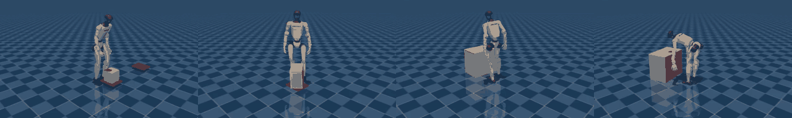
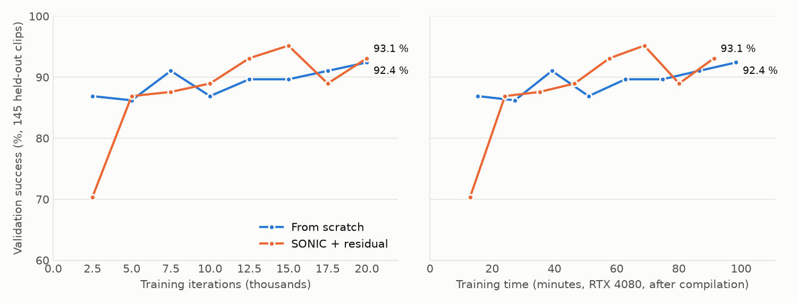

# supermimic_box



A low-level contact-flow tracker for box loco-manipulation on the **Unitree G1 (29 DoF, rubber
hands)**: the task of [OmniContact](https://github.com/Ingrid789/OmniContact)'s CFtrack, carrying
and pushing boxes of 90 sizes from the
[OmniContact dataset](https://huggingface.co/datasets/lightcone02/OmniContact-Dataset).

It is trained the [SuperMimic](https://arxiv.org/abs/2610.28480) way: with a learned world model
of the robot and the box and with differentiable actor rollouts inside that model, not PPO in the
simulator. Physics is MuJoCo-Warp through mjlab. 

Two checkpoints are released, trained with the same data, rewards and randomization:

- **From scratch** (`configs/release_scratch.json`): the policy outputs joint targets on its own.
- **SONIC + residual** (`configs/release_sonic.json`): the frozen pre-trained
  [GEAR-SONIC](https://github.com/NVlabs/GR00T-WholeBodyControl) whole-body tracker follows the
  joint reference, and the policy adds a residual to its action.

Both are evaluated on clips they never saw, with the dataset's own train/val/test split.

## Results

One training run per checkpoint (seed 0, 20,000 iterations, 1,024 worlds) on the 786 carry and push
training clips. A clip is **completed** when the episode reaches its last frame, and a **success**
when in addition the box stayed within 0.2 m and 0.8 rad of its reference, covered at least half of
the reference box's path, and was raised if the reference raises it. The counts are the
individual evaluations.

| Held-out clips | From scratch | SONIC + residual |
|---|---|---|
| Test, 139 | 85.6 % (119, 119) | **91.0 %** (127, 126) |
| Test, 139, randomized | 78.8 % (112, 107) | **80.2 %** (114, 109) |
| Validation, 145 | 92.4 % (134) | **93.1 %** (135) |
| Validation, 145, randomized | 84.8 % (123) | 84.8 % (123) |
| Test completion | 96.0 % | 96.4 % |
| Test success, carry (67 clips) | 89.6 % | 94.0 % |
| Test success, push (72 clips) | 81.9 % | 88.2 % |
| Test box position error, mean | 4.3 cm | 3.9 cm |

"Randomized" runs the evaluation under the training randomization and observation noise (two
seeds on test); the other rows are nominal. The two release checkpoints are
`logs/release_scratch/last.pt` and `logs/release_sonic/last.pt`.


### Learning progress

Validation success (145 held-out clips, nominal) of the checkpoint saved every 2,500 iterations:



| Iterations | 2,500 | 5,000 | 7,500 | 10,000 | 12,500 | 15,000 | 17,500 | 20,000 |
|---|---|---|---|---|---|---|---|---|
| From scratch | 86.9 % | 86.2 % | 91.0 % | 86.9 % | 89.7 % | 89.7 % | 91.0 % | 92.4 % |
| SONIC + residual | 70.3 % | 86.9 % | 87.6 % | 89.0 % | 93.1 % | 95.2 % | 89.0 % | 93.1 % |

The policy trained from scratch is at 87 % after 2,500 iterations (15 minutes). SONIC + residual
starts lower, because the untrained residual first disturbs a base policy that knows nothing about
the box; it overtakes from 12,500 iterations on. Single evaluations on 145 clips move by a few
points from one checkpoint to the next, so read the trend, not individual points.

### Training cost

On one NVIDIA RTX 4080 (16 GB):

| | From scratch | SONIC + residual |
|---|---|---|
| Time per iteration, median (p90) | 0.284 s (0.285 s) | 0.269 s (0.270 s) |
| Simulated transitions per second | 18,000 | 19,000 |
| 20,000 iterations | 98 min | 91 min |
| Device memory, peak | 12.0 GiB | 11.1 GiB |
| Actor batch | 2,048 | 1,024 |

The training graphs are compiled before the first iteration: up to 14 minutes the first time,
3.6 and 1.7 minutes with a warm compile cache. SONIC runs in full precision inside the imagined
rollouts and takes memory there, so its actor batch is half as large; the smaller batch more than
pays for evaluating SONIC, and its iterations end up slightly faster.


## Policy observation, and randomization

Per step of its 10-step history:

| Input | Size | Real source |
|---|---|---|
| Joint positions (minus encoder offset), joint velocities | 58 | encoders |
| Angular velocity, projected gravity | 6 | IMU |
| Previous action | 29 | known |
| Reference root orientation relative to the robot, root position error | 9 | localization |
| Box position, orientation and its 8 corners, relative to the robot | 33 | mocap or vision |
| Reference contact flags | 4 | reference |

Randomized in training: foot friction (0.6 to 1.2) and torso CoM per world; per episode, encoder
offsets, PD stiffness and damping of every joint (log-uniform 0.75 to 1.5), a roll, pitch and yaw
bias of the robot's orientation estimate (5, 5 and 8 degrees), the box's mass (0.5 to 1.5 times
2 kg) and friction (0.3 to 0.8 carried, 0.1 to 0.4 pushed); observation noise. All randomized
parameters are part of the context the world model and critic see.


## Setup

Python 3.12 and a CUDA GPU with 16 GB. Versions are pinned in `uv.lock` (the same as
supermimic_hoi_vibed):

```bash
uv sync --all-extras
```

Assets and references are built from an
[OmniContact_sim2sim](https://github.com/Ingrid789/OmniContact_sim2sim) checkout and the
OmniContact dataset's `npz_clips/box` and `metadata` folders (gated, 4.6 GB, CC BY-NC 4.0):

```bash
hf download lightcone02/OmniContact-Dataset --repo-type dataset --include "npz_clips/box/*" --include "metadata/*" --local-dir data/source/OmniContact-Dataset
uv run python -m supermimic_box.prepare --sim2sim /path/to/OmniContact_sim2sim --dataset data/source/OmniContact-Dataset
```

This writes `data/omnicontact/` (git-ignored): 1,070 clips (5.5 h; 617 carry, 453 push) resampled
from 90 to 50 Hz, 90 box sizes, and the split (786 train, 145 val, 139 test). Six carry clips with
joint angles far outside the robot's limits are left out, and so are the dataset's 190 slide clips
(the box is moved with the feet) unless `--tasks carry push slide` asks for them. Every box weighs
2 kg, as in OmniContact's training.

For the SONIC variant, place the release checkpoint ported to MuJoCo joint order (`mocke`'s
`pretrained/sonic/last_ported.pt`, NVIDIA Open Model License) at `data/sonic/last_ported.pt`.

Without `--dataset`, `prepare` builds 16 local clips (4.9 min) from the two checkouts instead
(`configs/box.json`), useful for a quick check of the pipeline.


## Usage

```bash
# Train the two release checkpoints
uv run python -m supermimic_box.train --config configs/release_scratch.json
uv run python -m supermimic_box.train --config configs/release_sonic.json

# Evaluate on held-out clips: completion and success rate per task, nominal or randomized
uv run python -m supermimic_box.evaluate logs/release_scratch/last.pt --split test
uv run python -m supermimic_box.evaluate logs/release_scratch/last.pt --split test --randomize --seed 1

# Record one clip and render it next to its reference
uv run python -m supermimic_box.evaluate logs/release_sonic/last.pt --split test --record push_box_37-50-55_131_6074253_001
uv run python -m supermimic_box.render --rollout results/evaluation_push_box_37-50-55_131_6074253_001.npz --dataset data/omnicontact/clips --object-assets data/omnicontact/objects --output results/rollout.mp4

# Check the scene against the references: open-loop playback of every clip
uv run python -m supermimic_box.audit --config configs/box.json

# Tests
uv run pytest
```

`scripts/plot_curves.py` draws the learning curves from `results/<run>/report.json`, and
`scripts/teaser.py` tiles rendered rollouts into the animation above.


## Layout

| File | Content |
|---|---|
| `prepare/` | robot MJCF, boxes and platform, clips and split |
| `robot.py` | joints, drives, tracked bodies, contact channels |
| `motion.py` | reference library, the contact-flow goal, reference stance |
| `sim.py`, `contacts.py` | MuJoCo CPU and batched MuJoCo-Warp physics; measured contact forces |
| `mdp.py` | observations, rewards, terminations (analytic, differentiable) |
| `env.py`, `reset_guard.py`, `randomization.py` | episodes, reset screening, randomization |
| `sonic.py`, `control.py` | the frozen SONIC base policy; actions to PD targets |
| `networks.py`, `runner.py`, `learning.py` | world model, contact head, actor, critic and their training |
| `evaluate.py`, `render.py`, `audit.py` | evaluation, videos, scene audit |
